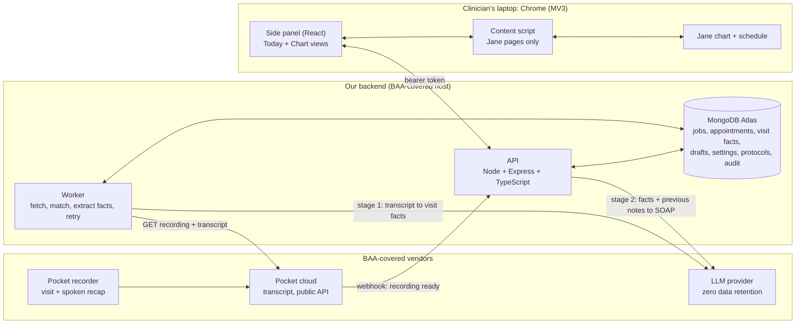
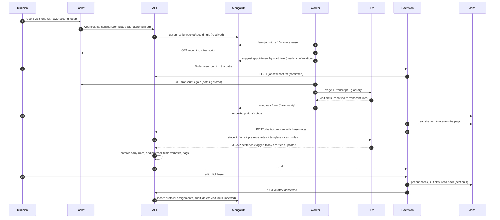
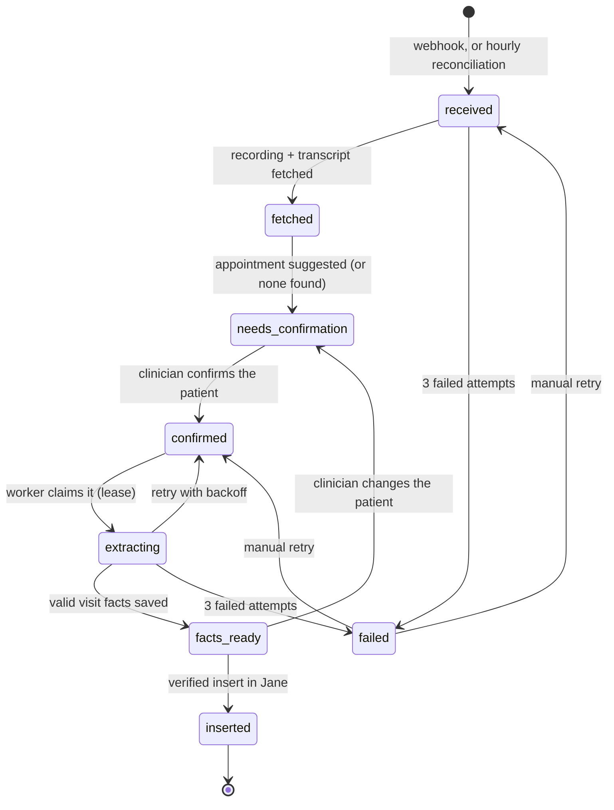
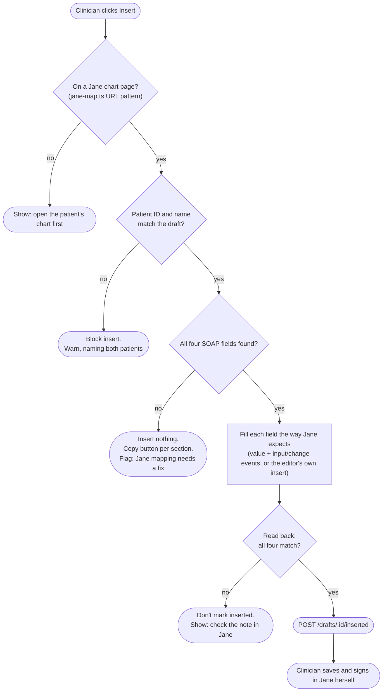
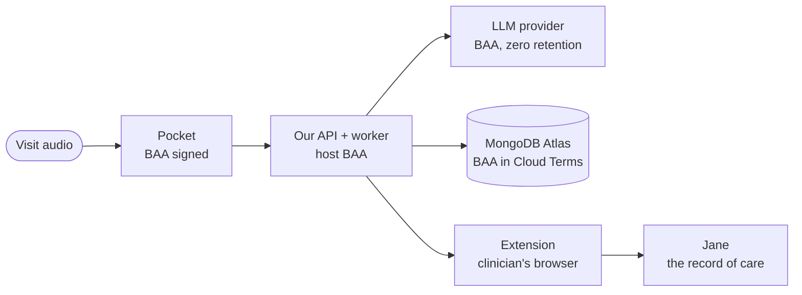

# Architecture

How the pieces of this repo fit together, in five diagrams. Each section names the code that holds the detail.

Built for one chiropractic practice and one clinician. Every transcript, note, and patient in this repo is synthetic. Not affiliated with or endorsed by Jane App.

---

## 1. The whole system

A Pocket recorder captures each visit. Pocket tells our API when a recording is ready, the worker turns it into a draft SOAP note, and the draft waits in a Chrome side panel until the clinician reviews it and clicks Insert. The API and the worker talk only through MongoDB, so either one can restart without losing work.

| Part | Where | Detail |
|---|---|---|
| Domain types | [`packages/shared/src/`](./packages/shared/src/) | zod schemas for jobs, visit facts, drafts with source tags, settings, protocols, API contracts |
| API | [`packages/server/src/api/app.ts`](./packages/server/src/api/app.ts) | Webhook, appointment sync, confirm, compose, insert, settings, protocols |
| Worker | [`packages/server/src/worker/worker.ts`](./packages/server/src/worker/worker.ts) | Leased job claims, Pocket fetch, matching, stage 1 extraction, retries, reconciliation |
| Pipeline | [`packages/server/src/pipeline/`](./packages/server/src/pipeline/) | Appointment matching, protocol matching, extract and compose prompts, carry rules |
| Data | [`packages/server/src/repos/`](./packages/server/src/repos/) | Repository interfaces, in-memory and MongoDB implementations, shared contract tests |
| Retention | [`packages/server/src/services/cleanup.ts`](./packages/server/src/services/cleanup.ts) | Scheduled deletion (section 5) |
| Extension | [`packages/extension/src/`](./packages/extension/src/) | Side panel, content script, [`jane-map.ts`](./packages/extension/src/jane-map.ts) |
| Decisions | [`docs/decisions.md`](./docs/decisions.md) | Why each piece is shaped this way |

**Stack:** TypeScript throughout. React in the extension, Node + Express on the server, MongoDB Atlas, zod for validation, Vitest for tests, Docker for the API and worker, GitHub Actions for CI.

---

## 2. One visit, end to end

The clinician touches a visit three times: recording it, confirming which patient it belongs to, and reviewing the draft before Insert. Drafting runs in two stages: the slow extraction happens in the background, and the note is written when she opens the chart, so it can use the previous notes on that page.

**Where the appointments come from:** the side panel's Sync button reads the day schedule Jane is showing and sends it to `POST /appointments/sync`.

**Previous notes** are read from the chart for each compose request and are not stored.

---

## 3. Job status

One job per recording. The worker claims a job by setting a 10-minute lease (`notBefore`); if a worker crashes, the lease runs out and the job is claimed again, so every step is safe to run twice. Failures retry after 1, 5 and 15 minutes, then wait for a manual retry.

| Rule | Why | Code |
|---|---|---|
| Unique index on `pocketRecordingId` | A duplicate webhook becomes a no-op | `repos/mongo.ts` |
| Leases instead of a stuck-job sweep | A crashed worker's job is picked up again with no extra job | `JobRepo.claimNext` |
| Extraction waits for a confirmed patient | The wrong patient's notes never reach the prompt | `TRANSITIONS` in `shared/src/jobs.ts` |
| Hourly reconciliation lists recent recordings from Pocket | A missed webhook still produces a job | `Worker.reconcile` |

---

## 4. Writing into Jane safely

Insert is the one step that touches the patient's chart, so it fails closed: if anything doesn't match, nothing is written and the clinician gets the text to copy instead.

The extension never clicks Jane's Save or Sign buttons, and fills fields only on a click. All Jane-specific selectors live in one file, [`jane-map.ts`](./packages/extension/src/jane-map.ts), so a change to Jane's pages is a one-file fix. The selectors are placeholders until the day 2 spike on a test patient; [`jane.test.ts`](./packages/extension/src/content/jane.test.ts) proves every fail-closed path against a synthetic page.

---

## 5. Where patient data lives

Patient data reaches four places, and each one is covered by a Business Associate Agreement. Our own database keeps as little as possible and deletes it on a schedule: a cleanup job does the deleting (it works on Postgres too), and MongoDB TTL indexes are a backstop.

| Collection | Patient data? | Kept for | Enforced by |
|---|---|---|---|
| `jobs` | No: IDs and status only | 30 days | Cleanup job |
| `appointments` | Name, Jane patient ID, time | 7 days | Cleanup job (TTL index as backstop) |
| `visitFacts` | Facts from today's visit | Deleted at insert; 7 days otherwise | Cleanup job (TTL index as backstop) |
| `drafts` | The draft note | 24 hours after insert; 7 days if never inserted | Cleanup job |
| `settings`, `templateVersions` | Her template and shorthand, de-identified examples | Kept; every version kept | n/a |
| `protocols`, `protocolAssignments` | Her library; which item was given to which Jane patient ID, when | Kept | n/a |
| `audit` | Jane patient ID, action, time | Kept, append-only | No update or delete in the code |

Previous notes read from Jane are used for one compose request and never stored. Transcripts are fetched from Pocket when needed and never stored.

**Never in logs:** transcripts, notes, or patient names. The logger's type only accepts IDs, statuses, counts and error messages ([`log.ts`](./packages/server/src/log.ts)).

**Secrets:** the Pocket key, LLM key, MongoDB URI, and extension token live in the host's secret manager and GitHub Actions secrets. The extension bundle gets only `API_URL` and `JANE_HOST`; the token is entered once on the options page and kept in `chrome.storage.local`. The server stores only its SHA-256 hash.

---

## Checks: what runs where

| Check | Runs in | Status |
|---|---|---|
| Shared: job transitions, source-tag rules, similarity | CI on every PR | 9 tests |
| Server: matching, protocol matching, carry rules, validation retry, worker leases and backoff, alerts, cleanup, Pocket client and webhook signatures, eval scorer, API end to end | CI on every PR | 62 tests |
| Repository contract on MongoDB | CI, against a `mongo:7` service | Runs in CI; skipped locally without `TEST_MONGODB_URI` |
| Extension: page detection, reading notes and schedule, every fail-closed insert path, Settings first-run | CI on every PR | 13 tests (synthetic page) |
| gitleaks, and a check that no audio, practice or env files are tracked | CI on every PR | `scripts/check-forbidden-files.mjs` |
| Draft test set: synthetic cases in the repo, her role-played visits from a private folder; zero invented findings | Manually before any prompt or model change (`pnpm --filter @soap-scribe/server eval`) | Runner built; real-model results pending (G-10) |

Results and dates go in [`docs/verification.md`](./docs/verification.md).
