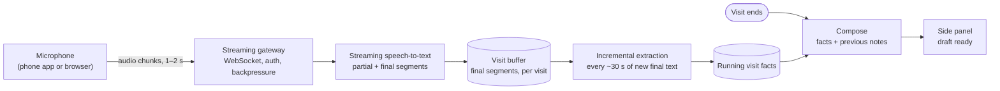

# Design note: a live scribe in the room

**Status:** design only, not built (decision D-10 chose batch on purpose). Written for the question "what would change if the note had to be ready when the visit ends?"

## Why batch was right for this practice

Bonnie already records every visit on Pocket and charts between visits or at the end of the day. Batch reuses Pocket's transcript, needs no microphone access in an MV3 extension, and leaves seconds to minutes for each step. Live mode is a different product promise: the draft is waiting the moment the visit ends.

## What changes

| Stage | Batch today | Live |
|---|---|---|
| Capture | Pocket device, uploaded after | Streamed audio in short chunks over a WebSocket |
| Transcript | Pocket's, after the visit | Streaming speech-to-text: partial text for display, final segments for extraction |
| Extraction | Once, after confirmation | Incrementally on final segments, merged into running facts; a final pass at the end |
| Patient | Confirmed after the recording, from the schedule | Chosen before recording starts (the open chart or the current appointment), so no confirmation step |
| Compose | When the chart is opened | When the visit ends, with previous notes fetched at the start |
| Failure | Retry with backoff, minutes are fine | Must degrade: keep recording locally, fall back to batch for that visit |

## Latency budget

Target: the draft is ready within 15 seconds of the visit ending.

| Step | Budget |
|---|---|
| Last audio chunk → final transcript segment | 2 s |
| Final extraction pass over the last segments | 4 s |
| Compose (facts already extracted, previous notes already fetched) | 7 s |
| Rules, protocol lines, evidence links, save | 1 s |
| Push to the side panel | 1 s |

Most of the work moves earlier: facts are extracted during the visit and previous notes are read when recording starts, so only compose sits on the critical path.

## Hard parts

- **Incremental extraction without duplicates.** Each pass sees only new final segments plus a summary of current facts; facts are keyed by kind and subject (a pain region, a spinal level) so a later "now it's a three" updates rather than adds. The final pass checks the whole transcript once.
- **Speakers.** Live diarization is less accurate than after the fact. The spoken recap at the end of the visit remains the most reliable source, as it is today.
- **Consent and pause.** A visible recording indicator, a one-tap pause, and nothing captured before the patient agrees ([consent.md](../consent.md)).
- **Network loss.** The client buffers audio locally and resumes; if the stream can't recover, the visit falls back to the batch path with the local recording.
- **Cost.** Streaming speech-to-text is billed by audio minute and incremental extraction adds model calls; batch on Pocket's transcript is cheaper. Live should be a per-practice choice, not the default.

## What stays

The job record (one per visit), cited facts, code-enforced carry rules, verbatim library text, and the fail-closed insert. Live mode changes how facts arrive, not how the note is checked or written.
