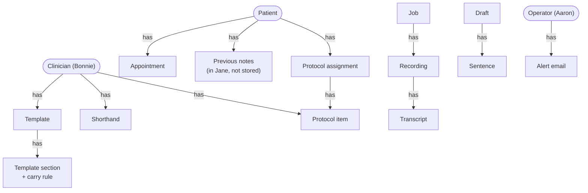
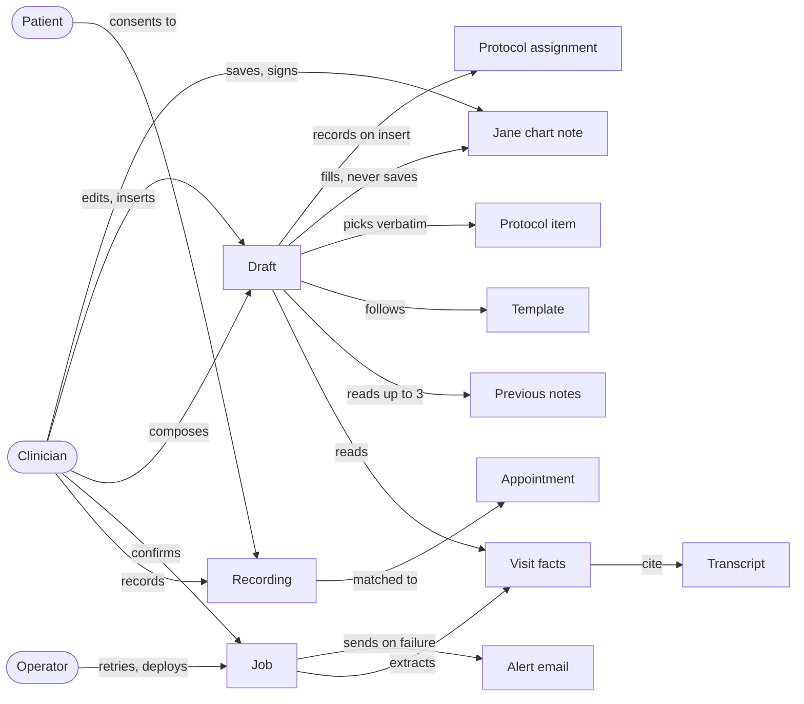

# Step 2 — System map

The players and actions highlighted in the [user stories](01-user-stories.md), drawn as one picture. Relationships use only three words: **has** (ownership), **being** (a state or role), **does** (an action one thing performs on another).

## Map

Drawn as two pictures so it stays readable: who **has** what, then who **does** what to what. States (**being**) are in the entity table below.

### Has

### Does

*Bonnie owns the settings (template, shorthand, protocols). The patient owns the appointment, previous notes and assignments. The job carries a recording from Pocket to facts; the draft brings facts, previous notes and protocols together, and only Bonnie saves it in Jane.*

## Entities

| Entity | Has | Being | Does | Story |
|---|---|---|---|---|
| Clinician | template, shorthand, protocol library | the only one who signs | records, confirms, edits, inserts, saves, signs | 1–5 |
| Patient | appointments, previous notes (in Jane), assignments | recorded only with consent | consents | 1, 3, 6 |
| Operator | alert inbox, deploy access | never sees patient data | deploys, retries | 7 |
| Appointment | time, Jane patient ID, patient name | today's schedule | — | 2 |
| Recording | transcript, start time, duration | matched or unmatched | — | 1, 2 |
| Transcript | segments (speaker, time, text) | deleted after insert | — | 1, 4, 6 |
| Job | recording, appointment, status, attempts | one of 8 states | extracts, alerts | 2, 7 |
| Visit facts | facts, each citing transcript segments | deleted after insert | — | 1, 4 |
| Previous note | the last up-to-3 Jane notes | read from the page, never stored | — | 1, 3, 4 |
| Draft | sentences per SOAP section, similarity to last | composed, edited, inserted | fills Jane, records assignments | 1, 4 |
| Sentence | text, source tag, from-note date, previous text | today / carried / updated / protocol | — | 1, 4 |
| Template / section | per-section carry rule, example, order | versioned | — | 5 |
| Shorthand | abbreviation → meaning | — | — | 5 |
| Protocol item | instruction text, frequency, category, keywords | active or archived | — | 1, 3, 5 |
| Protocol assignment | patient, protocol, date | history | — | 3 |
| Jane chart note | the note fields in Jane | Bonnie's, unsigned until she signs | — | 1 |
| Alert | job ID, error | — | — | 7 |

## Checked back against the stories

- Every player in the consolidated noun list appears, except **Google Doc** (replaced by Protocol item), **Schedule** (a list of Appointments), **Spinal level** and **Finding** (content of Visit facts and Sentences; attributes, not entities), and **Consent** (an action on Recording, handled off-system today: [G-02](../gaps.md)).
- **Date on clinical advice** (Story 1) has no home on the map: Sentence has a from-note date, but nothing puts the date given into Plan text. This became [G-17](../gaps.md).
- **Protocol assignment** exists and is recorded, but nothing on the map *reads* it back for the clinician (Story 3). This became [G-18](../gaps.md).
