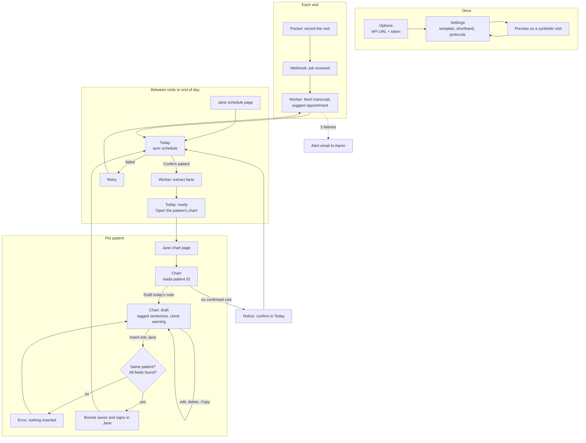

# Step 3 — Flow diagram

The screens that come out of the [system map](02-system-map.md), the order Bonnie moves through them, and a trace of every [user story](01-user-stories.md) through that flow. Sequence only; layout is Step 6.

## Screen list

| Screen | Where it lives | System map entities it shows | Code |
|---|---|---|---|
| **Options** (one-time setup) | Extension options page | — (API URL, token) | `packages/extension/src/options/index.ts` |
| **Today** | Side panel tab | Appointment, Job, Recording | `sidepanel/Today.tsx` |
| **Chart** | Side panel tab, follows the active Jane tab | Draft, Sentence, Previous note | `sidepanel/Chart.tsx` |
| **Settings → Template / Shorthand / Protocols / History / Preview** | Side panel tab | Template, Section, Shorthand, Protocol item | `sidepanel/Settings.tsx` |
| *Jane schedule page* | Jane (not ours) | Appointment | read by `content/jane.ts` |
| *Jane chart page* | Jane (not ours) | Previous note, Jane chart note | read and filled by `content/jane.ts` |
| *Pocket recorder / app* | Pocket (not ours) | Recording | webhook to `/webhooks/pocket` |
| *Alert email* | Aaron's inbox | Alert | `notify/notifier.ts` |

## Flow

*Recording and drafting are decoupled: Pocket and the worker run in the background, Today is where she confirms who each recording belongs to, and Chart is where a draft turns into a Jane note. She always ends by saving and signing in Jane herself.*

## Story trace

| Story | Path through the flow | Ends at the goal? | Dead ends or friction |
|---|---|---|---|
| 1. Charting a visit she just finished | Record → Today: confirm → Jane chart → Chart: Draft → edit → Insert → save/sign | Yes | Today says "open the chart" but doesn't link to it; she finds the patient in Jane herself (**G-22**). Plan items carry no date (**G-17**). |
| 2. Batch at end of day | Jane schedule → Today: sync → confirm each → Chart per patient | Mostly | A visit with **no recording** (recorder off, battery, upload stuck) doesn't appear in Today at all, and Chart can only say "no confirmed visit". Dead end (**G-23**). |
| 3. Deciding what to recommend next | Chart: Draft → Plan | **No** | Assignments are recorded on insert but no screen shows them, and compose doesn't read them (**G-18**). She's back to scrolling 8 notes in Jane. |
| 4. Returning patient, findings barely changed | Chart: Draft → carried/updated tags, "was:" tooltip, clone warning → edit | Yes | A "today" sentence can't be traced to the transcript line in the UI, though the facts cite it (**G-19**). |
| 5. Changing how she writes | Settings → edit → Preview → save (new version) → History → restore | Yes | — |
| 6. A patient being recorded | Off-system: consent at intake, sign in the room | **No** | No consent step exists yet (**G-02**). Retention is handled (facts deleted on insert, TTL backstops). |
| 7. Aaron, when something breaks | Worker retries 1/5/15 min → failed → alert email; Today: Retry; hourly reconcile | Yes | — |
| 8. Proving the time saving | Off-system timing | **No** | Not measured yet (**G-13**). |

## Update after the gap fixes

Stories 1–5 and 7 now reach their goal in the product (G-17, G-18, G-19, G-22, G-23 done). Story 6 (consent) and Story 8 (timing) remain off-system. The flow above gains: Today → **Open chart** → Chart, and Chart → **Draft from previous notes** when there's no recording.

## What this changed

Two stories don't reach their goal inside the product (3 and 6) and one has a hard dead end (2, missing recording). Those are now in [gaps.md](../gaps.md) as G-17, G-18, G-19, G-22 and G-23 with priorities, and in the [traceability matrix](traceability.md).
