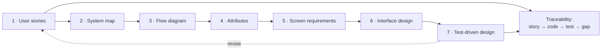

# UX process: SOAP Scribe

SOAP Scribe run through our 7-step UX/UI process (Amir Khella's method): each step's output feeds the next, from user goals to a tested design. The build came first here, so this folder does two jobs: it documents the experience the build is meant to deliver, and it **audits the build against the stories**, turning every shortfall into a gap.

| Step | File | Output | Status |
|---|---|---|---|
| 1 | [01-user-stories.md](01-user-stories.md) | 8 current-state stories across 3 roles, nouns and verbs highlighted, 21 needs (N-01 to N-21) | Written; **not yet read back to Bonnie** |
| 2 | [02-system-map.md](02-system-map.md) | Has / does maps, entity table, check against stories | Done |
| 3 | [03-flow-diagram.md](03-flow-diagram.md) | Screen list, flow, every story traced, dead ends flagged | Done |
| 4 | [04-attributes.md](04-attributes.md) | Attributes per entity with type and source; attributes the stories imply but the schema lacks | Done |
| 5 | [05-screen-requirements.md](05-screen-requirements.md) | Goals and A/B/C per screen, each checked against the build | Done |
| 6 | [06-interface-design.md](06-interface-design.md) | Patterns in the build; variations to sketch for the gaps | Sketches not done |
| 7 | [07-test-plan.md](07-test-plan.md) | 12 scenarios with pass/fail, session plan, six-mistakes checklist | No sessions run yet |
| — | [traceability.md](traceability.md) | Every need → code → automated test → UX test → status → gap | 10 met, 5 unproven live, 3 partly, 3 not met |

## What the audit found

- **Story 3 (what she's already assigned, and when) isn't met.** It's the reason she copies dated lines from note to note today. The data is already recorded on insert but never shown or dated: G-17, G-18.
- **A visit with no recording is a dead end** (Story 2): G-23.
- **Smaller:** sentence → transcript traceability (G-19), a link from Today to the chart (G-22), protocol categories and care phases (G-24).
- **Off-system:** patient consent (G-02) and the before/after timing (G-13) were already open.

New gaps are in [../gaps.md](../gaps.md).

## How to use this folder

- **Before building a gap fix:** find its need in [traceability.md](traceability.md), read the story, sketch the variations in Step 6, then build.
- **After a test session:** add notes to `sessions/` (de-identified), revise the stories, re-run the traceability table.
- **When a story changes:** walk it forward through steps 2–5; the "checked back against the stories" sections show where.

## Sources

- Process: UX/UI Design Process handbook and the Step 1 and Step 2 method docs (Claude Docs, November 2026).
- Bonnie's stories: her first recorded brain dump and the grndwrk story sessions (April 2026), and what Aaron reported during the build (November 2026). The wider perinatal-app stories (patient portal, co-managing providers) are listed as out of scope in Step 1.
